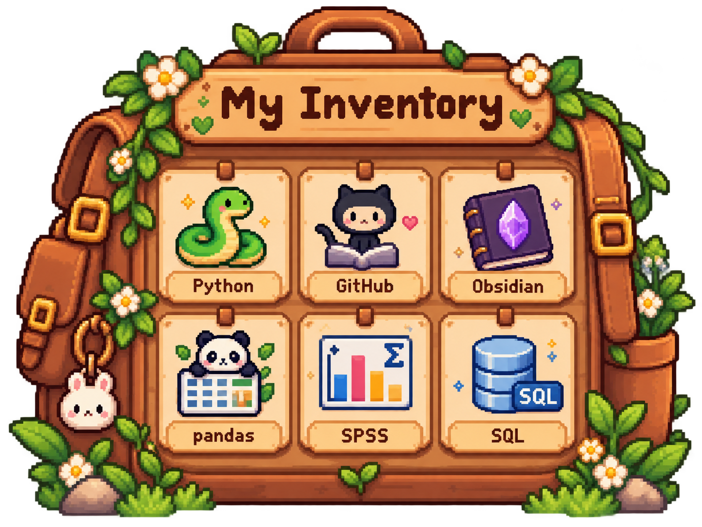

  

# 🌱 Welcome to Xinyue's Little Farm 🌱

### A Data Science Student's Journey

*Planting curiosity, growing knowledge, harvesting insights.*

🌸 🌷 🌻 🍓 🌿

---

### 🌼 Spring, Year 1 🌼

*Every great adventure starts with a little seed.*

## 👩🏻‍🌾 Farmer's Profile

Hi there! I'm **Xinyue**!

I'm currently pursuing an MSc in Data Science in the UK.

Welcome to my little corner of GitHub, where I document my learning journey, grow my technical skills, and share the projects I've been working on.

- 🏡 **Location:** United Kingdom
- 🌱 **Currently Learning:** Python & Data Science
- 📊 **Interests:** Data Analysis & Visualisation
- 🎮 **Favourite Game:** Stardew Valley, Valorant (Immortal player)

---

## 🎒 My Inventory

*Tools and skills collected along my journey.*

*Every new skill is another item unlocked! 🌱*

---

### ✨ Skill Collection

*More items will be unlocked along the journey...*

---

### 🌾 My Farm Projects

*Every project starts as a little seed.*

| 🌱 Project | 📖 Description | 🌤️ Status |
|:---|:---|:---:|
| Python Practice | Exploring Python fundamentals and APIs | Growing 🌱 |
| Data Visualisation | Learning to tell stories through data | Growing 🌱 |
| Data Analysis | Developing analytical and statistical skills | Growing 🌱 |

 

🍓 *More projects will bloom as my journey continues.*

---

### 🌻 Thanks for Visiting My Farm!

*Every expert was once a beginner farmer.*

🍓 Happy Coding! 🍓

