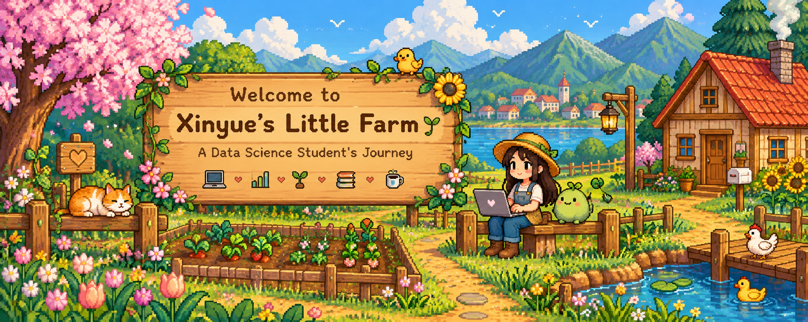

  

# 🌱 Welcome to Xinyue's Little Farm 🌱

### A Data Science Student's Journey

*Planting curiosity, growing knowledge, harvesting insights.*

🌸 🌷 🌻 🍓 🌿

---

### 🌼 Spring, Year 1 🌼

*Every great adventure starts with a little seed.*

## 👩🏻‍🌾 Farmer's Profile

Hi there! I'm **Xinyue**!

I'm currently pursuing an MSc in Data Science in the UK.

Welcome to my little corner of GitHub, where I document my learning journey, grow my technical skills, and share the projects I've been working on.

- 🏡 **Location:** United Kingdom
- 🌱 **Currently Learning:** Python & Data Science
- 📊 **Interests:** Data Analysis & Visualisation
- 🎮 **Favourite Game:** Stardew Valley, Valorant (Immortal player)

---

## 🎒 My Inventory

*Tools and skills collected along my journey.*

### 🌿 Currently Equipped

| 🐍 | 🌿 | 📓 |
|:---:|:---:|:---:|
| **Python** | **Git & GitHub** | **Obsidian** |
| Equipped | Equipped | Equipped |

### 🌱 Skills in Progress

| 📊 | 📈 | 🗃️ |
|:---:|:---:|:---:|
| **pandas** | **SPSS** | **SQL** |
| Learning | Learning | Growing |

### ✨ Skill Collection

*More items will be unlocked along the journey...*

---

## 🌾 My Farm Projects

*The seeds have been planted. More projects coming soon!*

| 🌱 Crop | 📖 Description | 🌤️ Season |
|:---|:---|:---|
| Python Practice | Learning Python fundamentals | Growing 🌱 |
| Data Visualisation | Exploring visual storytelling with data | Growing 🌱 |
| Data Analysis | Developing analytical skills | Growing 🌱 |

---

### 🌻 Thanks for Visiting My Farm!

*Every expert was once a beginner farmer.*

🍓 Happy Coding! 🍓

